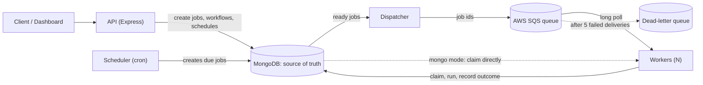
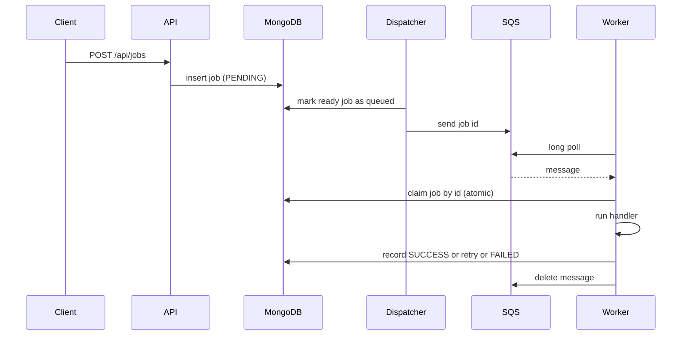
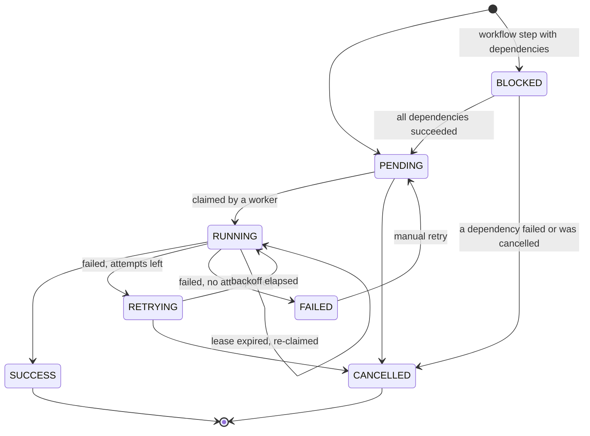
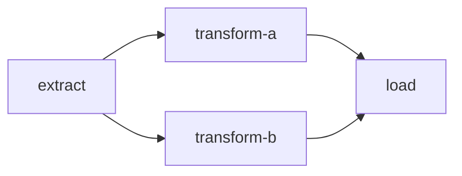

# Distributed Job Scheduler & Workflow Engine

A backend system that runs background jobs **reliably**: jobs survive worker crashes, failed jobs retry with backoff, duplicate submissions are ignored, multi-step workflows run in dependency order, and recurring jobs fire exactly once even with several schedulers running.

MongoDB is the source of truth. Jobs can be delivered to workers directly from MongoDB or through **AWS SQS**.

> **Status:** backend complete (API, workers, scheduler, dispatcher, SQS mode, tests). React dashboard, Docker, CI/CD and AWS deployment are in progress.

## Features

- **Reliable execution:** atomic job claiming, lease-based crash recovery, retries with exponential backoff and jitter, per-job timeouts, bounded concurrency, graceful shutdown
- **Idempotent submission:** an `Idempotency-Key` header makes client retries safe
- **Workflows (DAGs):** steps declare dependencies; independent steps run in parallel; a failure cancels everything downstream
- **Cron schedules:** 5-field cron expressions with IANA timezones; safe to run several schedulers at once
- **Two delivery modes:** `mongo` (workers claim straight from MongoDB) or `sqs` (long-polling workers, dead-letter queue)
- **Tested at two levels:** fast unit tests, plus integration tests against a real MongoDB that prove the race conditions are solved

## Architecture



| Process | Role |
|---|---|
| **API** | Accepts jobs, workflows and schedules; reports status |
| **Worker** | Claims a job atomically, runs its handler, records the outcome |
| **Scheduler** | Turns due cron schedules into jobs |
| **Dispatcher** | (SQS mode) Puts ready jobs on the queue |

An SQS message carries only a job id. The job itself, its status and its history always live in MongoDB.

### How a job flows (SQS mode)



### Job lifecycle



Every status change goes through a state machine (`src/core/stateMachine.js`) that rejects illegal moves.

### Workflows



`transform-a` and `transform-b` run in parallel once `extract` succeeds. `load` waits for both. If `extract` fails, everything after it is cancelled.

## Key design decisions

| Problem | Solution |
|---|---|
| Two workers grab the same job | One atomic `findOneAndUpdate` claims it (`claimNext` / `claimById`); the loser matches nothing |
| A worker dies mid-job | Jobs are claimed with a **lease**; once it expires, another worker re-claims the job. A housekeeping pass fails jobs that crashed on their final attempt |
| A slow worker finishes after losing its lease | Every outcome write is conditional on "still RUNNING and still mine", so a late write is refused |
| Failing jobs hammer a struggling service | Exponential backoff with jitter (1s base, 60s cap), stored as `runAt`: the database is the timer |
| Client retries create duplicate jobs | `Idempotency-Key` plus a unique sparse index; simultaneous duplicates are resolved by the database |
| Cron fires twice, or not at all, across several schedulers | Each firing creates a job with a deterministic key (`schedule:<id>:<fire time>`) and advances `nextRunAt` with an optimistic check. Missed runs after downtime are skipped, not replayed |
| Steps must wait for their dependencies | `BLOCKED` status; finishing a job re-checks only the steps waiting on it. Cycles are rejected at creation (Kahn's algorithm) |
| A crash between "job finished" and "next step released" | A reconciler re-checks every blocked step; the check is idempotent |
| SQS delivers messages at least once | The atomic claim makes duplicates harmless; messages are deleted only **after** the outcome is recorded |
| A crashed worker's SQS message | The visibility timeout is longer than the lease, so the message only reappears after the lease has expired |
| Writing to MongoDB and SQS can't be atomic | A dispatcher marks jobs `queuedAt` atomically before sending, undoes the mark if the send fails, and re-queues jobs whose message may have been lost |
| No transactions for creating a workflow | Steps with dependencies are inserted first (blocked), dependency-free steps last, so nothing runs until the whole graph exists |

## Tech stack

Node.js, Express, MongoDB (Mongoose), AWS SQS (SDK v3), cron-parser, Jest and Supertest.

## Getting started

**Prerequisites:** Node.js 20+, a MongoDB database (a free Atlas cluster works), and optionally an AWS account for SQS mode.

```bash
cd backend
npm install
cp .env.example .env        # Windows: copy .env.example .env
# edit .env and set MONGO_URI
```

Run each process in its own terminal:

```bash
npm run dev          # API on http://localhost:3000
npm run worker       # a worker (run several to scale out)
npm run scheduler    # optional: only needed for cron schedules
```

### SQS mode (optional)

```bash
# add AWS_REGION, AWS_ACCESS_KEY_ID and AWS_SECRET_ACCESS_KEY to .env
npm run sqs:create   # creates the queue and its dead-letter queue; prints SQS_QUEUE_URL
# add SQS_QUEUE_URL and QUEUE_MODE=sqs to .env
npm run sqs:check    # verifies credentials and shows queue stats
npm run dispatcher   # in addition to the API and worker
```

## API

| Method | Path | Description |
|---|---|---|
| POST | `/api/jobs` | Submit a job (optional `Idempotency-Key` header) |
| GET | `/api/jobs` | List jobs (`?status=&type=&limit=&skip=`) |
| GET | `/api/jobs/:id` | Get one job |
| POST | `/api/jobs/:id/cancel` | Cancel a job that has not started |
| POST | `/api/jobs/:id/retry` | Re-queue a FAILED job |
| POST | `/api/workflows` | Create a workflow of dependent steps |
| GET | `/api/workflows` | List workflows with their overall status |
| GET | `/api/workflows/:id` | A workflow and all its steps |
| POST | `/api/workflows/:id/cancel` | Cancel every step that has not started |
| POST | `/api/schedules` | Create a recurring job |
| GET | `/api/schedules` | List schedules |
| GET | `/api/schedules/:id` | Get one schedule |
| POST | `/api/schedules/:id/pause` | Pause a schedule |
| POST | `/api/schedules/:id/resume` | Resume a schedule |
| DELETE | `/api/schedules/:id` | Delete a schedule |
| GET | `/health` | Liveness: the process is up |
| GET | `/ready` | Readiness: the database is connected |

Built-in handlers (`src/worker/handlers.js`): `echo`, `sleep`, `flaky`, `alwaysFail`. Add your own by adding a function there.

**Submit a job**
```bash
curl -X POST http://localhost:3000/api/jobs \
  -H "Content-Type: application/json" \
  -H "Idempotency-Key: order-123" \
  -d '{"type":"echo","payload":{"message":"hello"},"maxAttempts":3}'
```

**Create a workflow** (`POST /api/workflows`)
```json
{
  "name": "nightly-pipeline",
  "steps": [
    { "name": "extract",     "type": "sleep", "payload": { "ms": 2000 } },
    { "name": "transform-a", "type": "sleep", "payload": { "ms": 2000 }, "dependsOn": ["extract"] },
    { "name": "transform-b", "type": "sleep", "payload": { "ms": 3000 }, "dependsOn": ["extract"] },
    { "name": "load",        "type": "echo",  "payload": { "msg": "done" }, "dependsOn": ["transform-a", "transform-b"] }
  ]
}
```

**Create a schedule** (`POST /api/schedules`)
```json
{ "name": "morning-ist", "type": "echo", "cron": "0 9 * * *", "timezone": "Asia/Kolkata" }
```

## Configuration

| Variable | Default | Meaning |
|---|---|---|
| `PORT` | `3000` | API port |
| `MONGO_URI` | none | MongoDB connection string |
| `QUEUE_MODE` | `mongo` | `mongo` or `sqs` |
| `SQS_QUEUE_URL` | none | Required when `QUEUE_MODE=sqs` |
| `AWS_REGION` | `ap-south-1` | Region for SQS |
| `WORKER_CONCURRENCY` | `3` | Jobs a worker runs at once |
| `POLL_INTERVAL_MS` | `1000` | Idle pause between polls (mongo mode) |
| `LEASE_MS` | `30000` | How long a claimed job is owned before it can be re-claimed |
| `JOB_TIMEOUT_MS` | `20000` | Per-job timeout. **Must be less than `LEASE_MS`** |
| `SCHEDULER_TICK_MS` | `1000` | How often the scheduler checks for due schedules |
| `DISPATCH_TICK_MS` | `1000` | How often the dispatcher looks for ready jobs |
| `REDISPATCH_AFTER_MS` | `300000` | Re-queue a job still waiting this long after being queued |
| `SQS_WAIT_SECONDS` | `20` | Long-poll duration (0 to 20) |
| `SQS_VISIBILITY_MARGIN_SECONDS` | `5` | Extra hide time on top of the lease |
| `MONGO_TEST_URI` | none | Integration tests only. The database name **must end in `_test`** |

## Testing

```bash
npm test                  # unit tests: no database needed
npm run test:integration  # real MongoDB: needs MONGO_TEST_URI
```

- **Unit tests** cover the state machine, backoff, cron, DAG validation, services, routes, workers, dispatcher and SQS wrapper, using mocks.
- **Integration tests** run the real services against MongoDB and prove the hard parts: concurrent claimers never double-claim, duplicate submissions create one job, a dead worker's job is recovered, steps run in dependency order and in parallel, two schedulers fire a schedule once, and duplicate SQS deliveries never run a job twice.
- The integration suite deletes everything in its database, so it **refuses to run** unless the database name ends in `_test`.

Demo scripts that reproduce the original bugs and show them fixed:

```bash
npm run race   # naive claim vs atomic claim with 5 concurrent workers
npm run idem   # 20 simultaneous requests with one Idempotency-Key
```

## Project structure

```
backend/
  src/
    core/         pure logic: state machine, backoff, cron, DAG, config parsing
    models/       Job, Workflow, Schedule
    services/     job, workflow, schedule, dependency and dispatch logic
    routes/       REST endpoints
    worker/       the worker loop and its job sources (MongoDB or SQS)
    scheduler/    cron scheduler process
    dispatcher/   MongoDB-to-SQS dispatcher process
    queue/        SQS wrapper
  scripts/        race and idempotency demos, SQS setup
  tests/          unit tests; tests/integration for the real-database suite
```

## Trade-offs and known limitations

- **At-least-once execution.** A job can run more than once (retries, re-claims), so handlers must be idempotent.
- **No lease heartbeat yet.** A job running longer than `LEASE_MS` can be re-claimed while still running. Keep `JOB_TIMEOUT_MS` below `LEASE_MS`.
- **Retrying one failed workflow step is not supported** (the steps after it are already cancelled). A "retry workflow" operation is future work.
- **Steps don't pass data to each other** yet.
- **Standard SQS queue:** no ordering guarantee, by design.
- **Workflow creation is best-effort atomic.** The insertion order prevents partial runs, but a transaction would be the production answer.
- **One Node thread per process.** CPU-heavy handlers would need worker threads or separate processes.
- **No authentication yet.** Add it before exposing the API publicly.

## Roadmap

React dashboard, Docker, GitHub Actions CI/CD, AWS EC2 deployment, and k6 load tests.

## Benchmarks

Load-test results will be added after deployment.